<p align="center">
  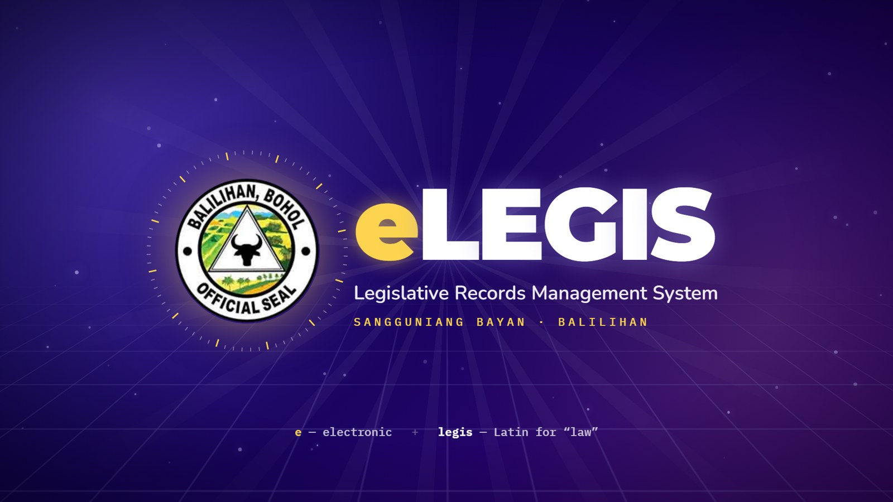
</p>

<h1 align="center">eLEGIS</h1>

<p align="center">
  <b>Legislative Records Management System for the Sangguniang Bayan of Balilihan, Bohol</b><br/>
  <i>Know your laws. Shape your town.</i>
</p>

<p align="center">
  
  
  
  
  
  
</p>

---

**eLEGIS** (*e* for electronic, plus *legis*, Latin for "law") moves the legislative work of the
Sangguniang Bayan (SB) of Balilihan from paper to the web. Ordinances, resolutions, session minutes, the order
of business and the council calendar now live in one role-based system. Every change is recorded.

This repository is the **SB Office System**, the staff-facing app used inside the SB office.
The public companion site, where residents read published records, lives in
[**eLEGIS — Public Website**](https://github.com/ferdiie/eLEGIS---Public-Website). Both apps share the same Supabase database.

```
 ┌──────────────────────────┐        ┌──────────────────────────┐
 │  SB Office System (this) │        │  Public Legislative      │
 │  React + Vite  →  Vercel │        │  Portal (separate repo)  │
 └────────────┬─────────────┘        └────────────┬─────────────┘
              │ REST + JWT                         │ read-only
 ┌────────────▼─────────────┐                      │
 │  Express API  →  Render  │                      │
 └────────────┬─────────────┘                      │
              └──────────────► Supabase (PostgreSQL + Storage) ◄┘
```

## Screenshots

| Login | Dashboard |
|---|---|
| 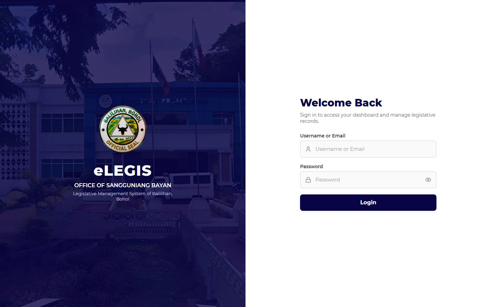 | 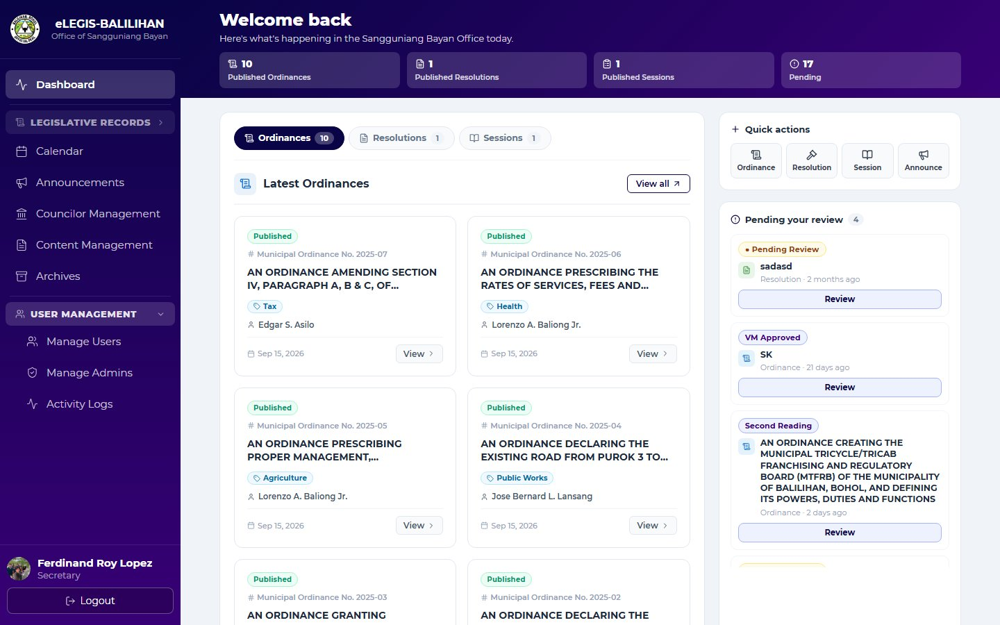 |
| **Ordinances** | **Record review** |
| 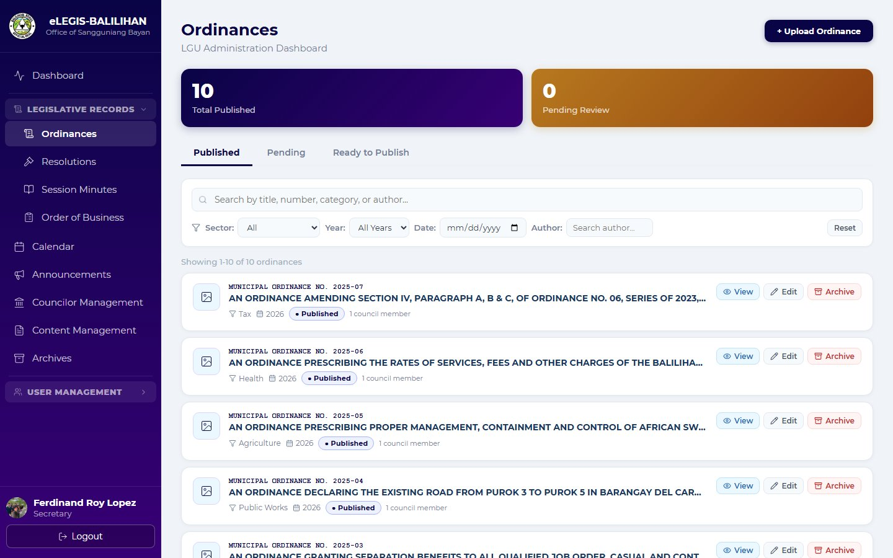 | 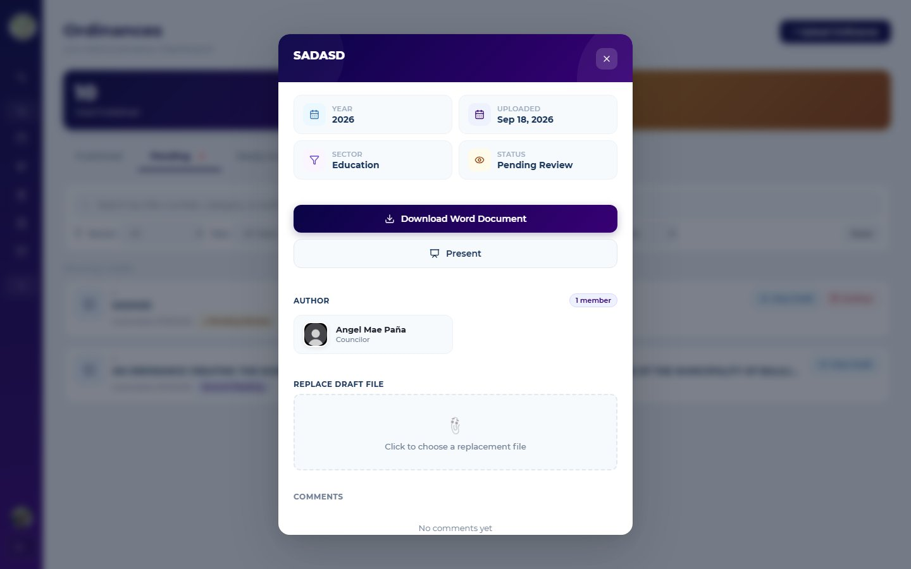 |
| **Session minutes & agenda** | **Calendar & schedule** |
| 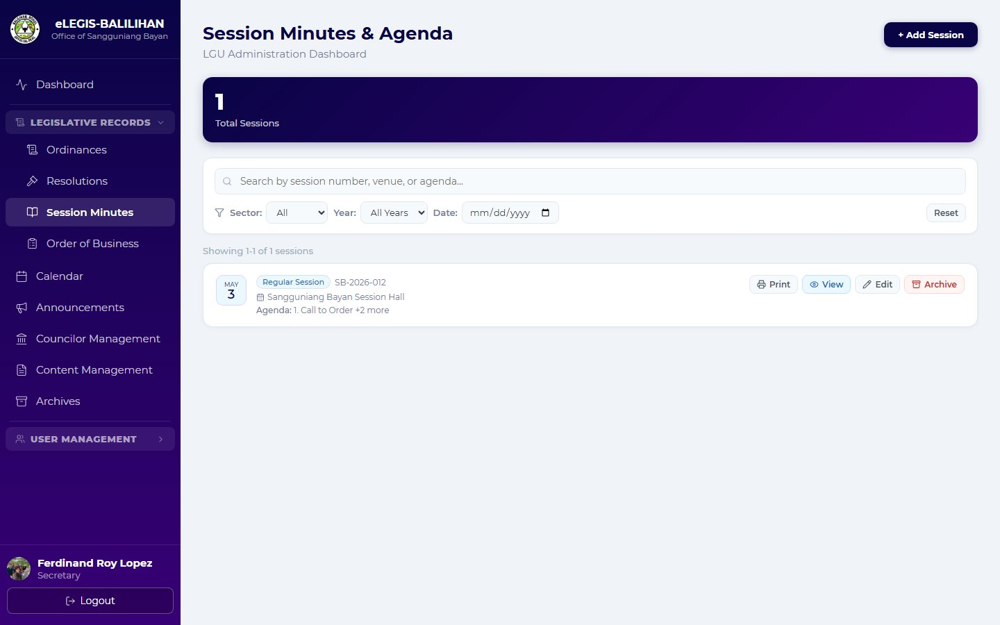 | 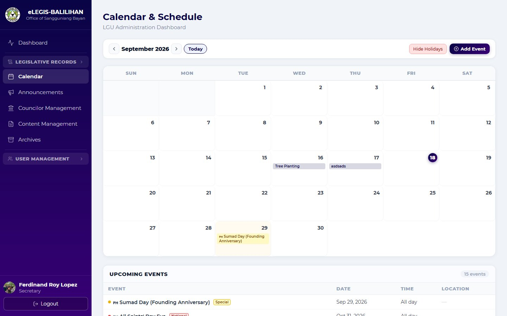 |
| **Council management** | **Content management** |
| 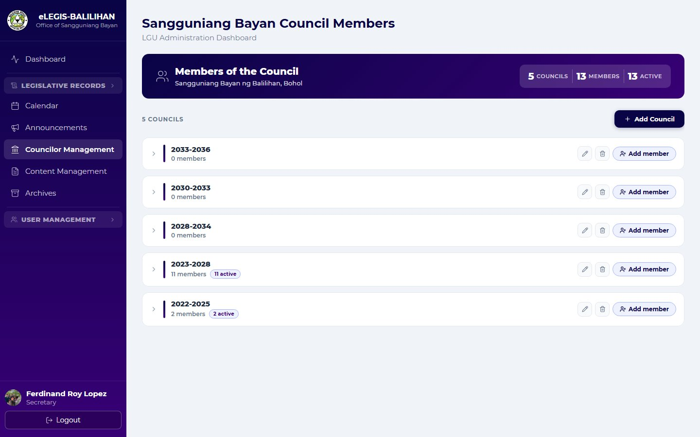 | 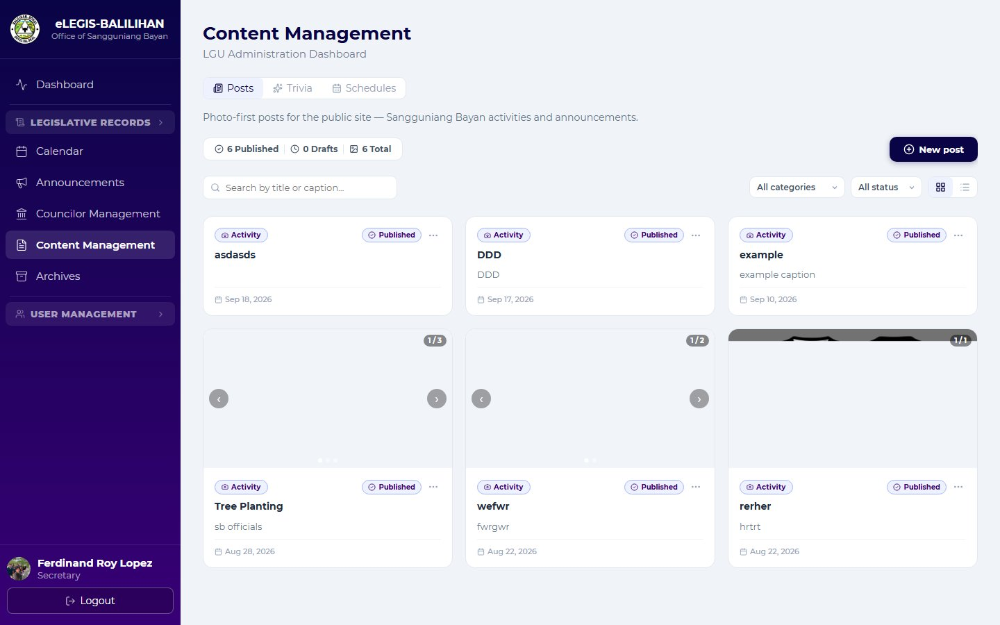 |
| **Activity logs** | **Archives** |
| 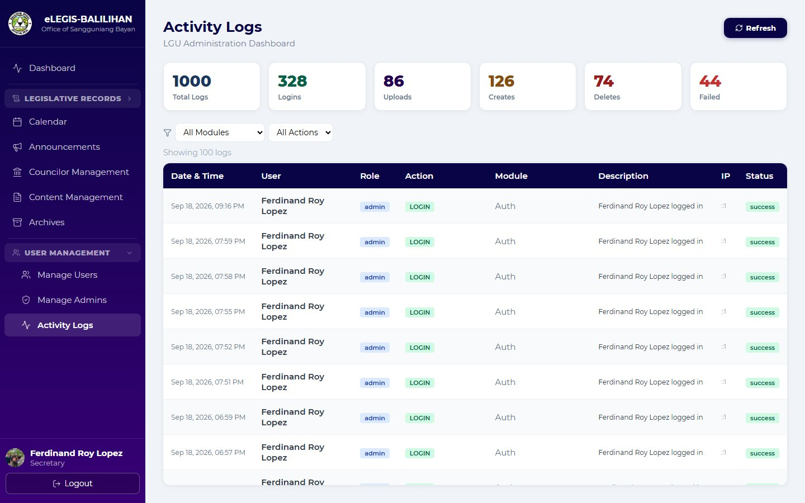 | 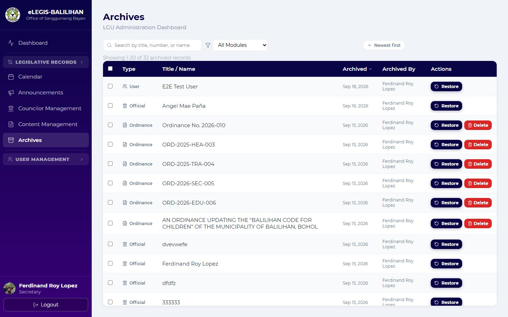 |

## Features

### Legislative records
- **Ordinances and resolutions.** Upload, review, edit, publish and archive them. Each record has a category, its authors and the council term it belongs to.
- **Author-approval workflow.** A record moves through these stages:
  `Pending Review → Accepted → First → Second → Third Reading → VM Approved → Ready to Publish → Published`.
  It can also be sent back as *Needs Revision* or *Rejected*. The tagged authors approve each stage.
- **Official numbering.** Numbers run in sequence per year and per record type, with no gaps or reuse. Older records can be encoded under past years, for example `RESOLUTION NO. 03-2019`.
- **Duplicate trap.** The same title or official number can't be used on two records. The check ignores letter case, spacing and stray punctuation.
- **Reads uploaded files.** It reads PDF, Word and image uploads, using OCR (Tesseract) for scanned pages, and suggests the record's number and date from them.
- **Record history.** Every record keeps an append-only trail from upload to publish, visible to staff only.
- **Session minutes and order of business.** These have their own upload, search and filter tools.

### Council and office
- **Councils and terms.** Manage councils, their terms and members. Councilors, the Vice-Mayor, the Liga ng mga Barangay and the SK Federated seats are all supported, and re-elected members carry over.
- **Calendar and schedule.** Official and personal events, plus holidays. A daily job sends a reminder email for the next day's official events.
- **Announcements and content.** Posts with image carousels, trivia and schedules feed the public portal.
- **Comments and reactions** on announcements.

### Accounts and security
- **Role-based access control.** There are two roles. Admins are the Secretary and the Clerk; users are Councilors, the Vice-Mayor, the Liga ng mga Barangay and the SK Federated.
  Routes are gated by role and position (for example *secretary-only* and *vice-mayor-only*).
- **JWT authentication.** bcrypt password hashing, rate limiting, Helmet headers and input validation.
- **Temporary passwords.** A new account must change its password on first login. Password resets go out by email through Brevo.
- **Linked accounts.** A staff login can be linked to the council member it belongs to.
- **Activity logs** for every login, create, update, delete and failure.
- **Archives and restore.** Archived session minutes and orders of business are permanently purged after 3 years.
- **Guided product tour** for first-time users (driver.js).

## Tech stack

| Layer | Tools |
|---|---|
| Frontend | React 19, Vite 7, React Router 7, TanStack Query, lucide-react, driver.js, CSS Modules |
| Backend | Node.js 22, Express 5, JWT, bcrypt, express-validator, express-rate-limit, Helmet, multer, node-cron |
| Documents | pdfjs-dist, pdf2json, mammoth, word-extractor, tesseract.js, @napi-rs/canvas |
| Data | Supabase (PostgreSQL + Storage) |
| Email | Brevo (Sendinblue) transactional API |
| Hosting | Vercel (frontend), Render (API, `render.yaml` blueprint) |

## Project structure

```
SB_OFFICE_SYSTEM/
├── my-app/                 # React frontend (Vite)
│   ├── src/
│   │   ├── AdminDashboard/ # pages: Ordinances, Resolutions, Sessions, Calendar, Users, Archives, Logs…
│   │   ├── LogIn.jsx       # login screen
│   │   └── ResetPassword.jsx
│   └── vercel.json         # SPA rewrites
├── my-backend/             # Express API
│   ├── routes/             # one file per resource (ordinances, resolutions, councils, archives…)
│   ├── helpers/            # workflow, numbering, duplicates, OCR/text extraction, cron jobs, email
│   ├── middleware/         # auth (JWT + role/position gates), uploads, rate limiting
│   ├── migrations/         # numbered SQL migrations (run in the Supabase SQL editor)
│   └── tests/              # end-to-end API tests
├── docs/                   # README images
└── render.yaml             # Render blueprint for the API
```

## Getting started

### Prerequisites
- Node.js **22.x**
- A [Supabase](https://supabase.com) project
- *(Optional)* A [Brevo](https://www.brevo.com) account for password-reset and reminder emails

### 1. Database
Open the Supabase **SQL Editor** and run the files in `my-backend/migrations/` in numeric order (`001_…` up to the latest).
See [`my-backend/migrations/README.md`](my-backend/migrations/README.md) for the conventions.

### 2. Backend
```bash
cd my-backend
npm install
```
Create `my-backend/.env`:
```env
PORT=5000
JWT_SECRET=change-me-to-a-long-random-string
SUPABASE_URL=https://<your-project>.supabase.co
SUPABASE_SERVICE_ROLE_KEY=<service-role-key>
FRONTEND_URL=http://localhost:5173
# optional
CORS_ORIGINS=
BREVO_API_KEY=
BREVO_SENDER_EMAIL=
LOGO_URL=
```
```bash
npm start            # http://localhost:5000  (health check: /api/health)
```

### 3. Frontend
```bash
cd my-app
npm install
```
Create `my-app/.env`:
```env
VITE_API_URL=http://localhost:5000
VITE_SUPABASE_URL=https://<your-project>.supabase.co
```
```bash
npm run dev          # http://localhost:5173
```

> **Never commit `.env` files.** The service-role key gives full database access.

## Testing

The tests are end-to-end scripts that run against a live API and your Supabase project.

```bash
cd my-backend
npm start            # terminal 1
npm test             # terminal 2
```

They cover authentication and role gates, the review workflow, archive and restore, duplicates, record numbering, account links and re-election.
See [`my-backend/tests/README.md`](my-backend/tests/README.md).

## Deployment

| Part | Platform | Notes |
|---|---|---|
| API | **Render** | Dashboard → *New → Blueprint* → pick this repo. `render.yaml` sets up the service and asks for the secret values. |
| Frontend | **Vercel** | Root directory `my-app`, framework *Vite*. Set `VITE_API_URL` to the Render URL and `VITE_SUPABASE_URL`. |

After deploying, set the API's `FRONTEND_URL` to the Vercel address so that CORS and password-reset links work.

## Related

- 🌐 **Public website:** [ferdiie/eLEGIS---Public-Website](https://github.com/ferdiie/eLEGIS---Public-Website)
  is the read-only portal where residents browse published ordinances, resolutions, session minutes and councilor profiles.

## Team

A thesis for the degree of **Bachelor of Science in Information Technology**,
College of Computing and Information Sciences, **Bohol Island State University – Balilihan Campus**.

- Ferdinand Roy L. Lopez
- Shani A. Gementiza
- Christian C. Pagapong

Built for the **Sangguniang Bayan ng Balilihan, Bohol**.
